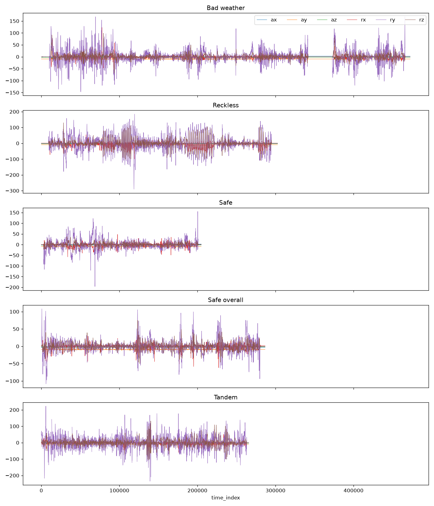
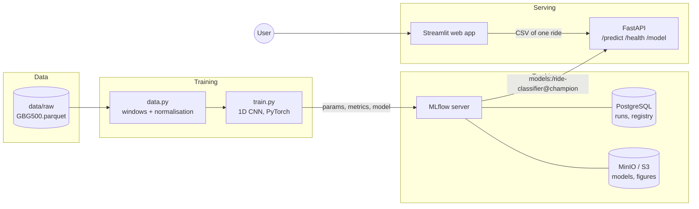
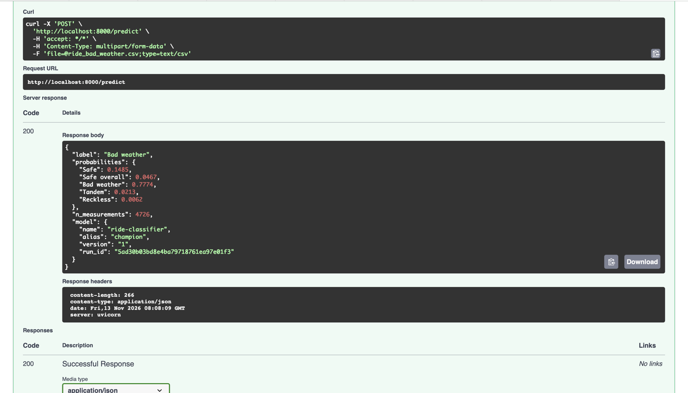
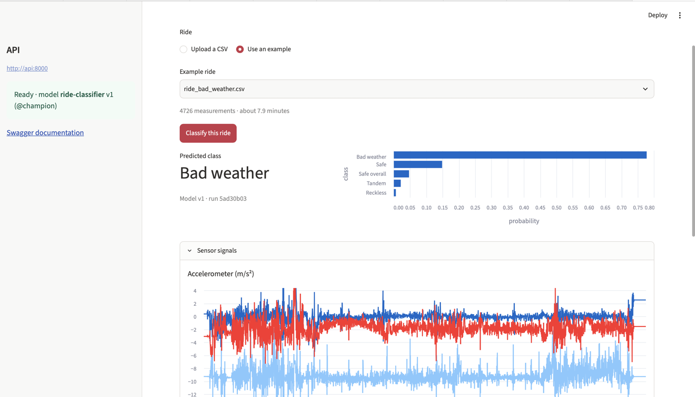
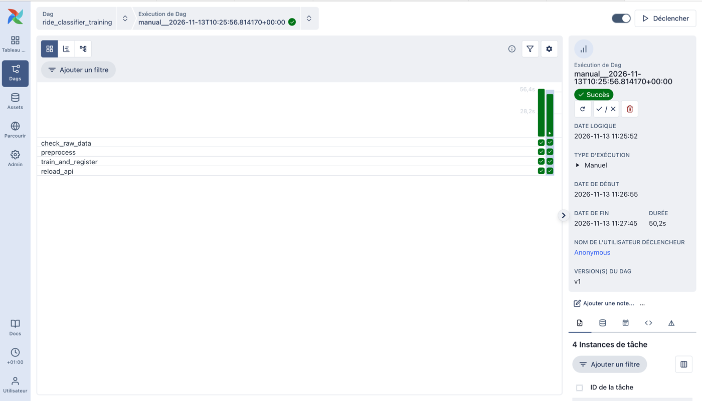
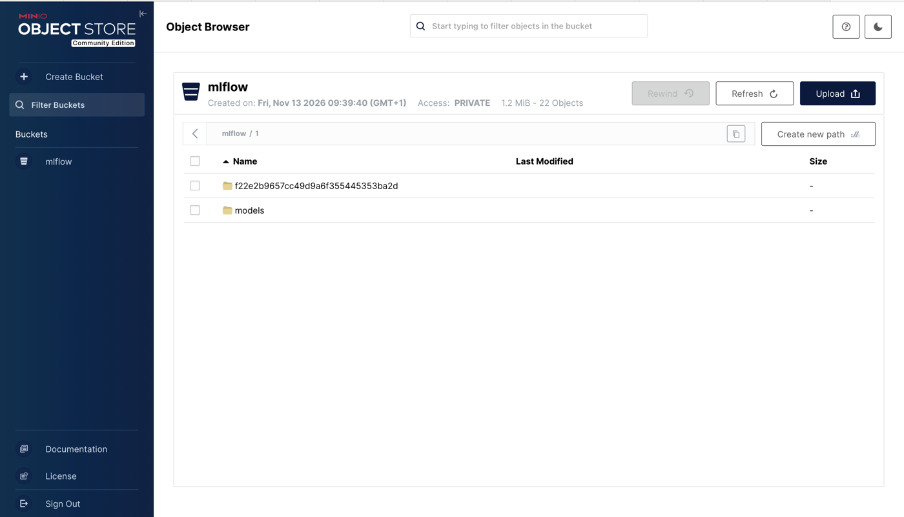

# Ride Classifier: MLOps and AI Infrastructure

[](https://github.com/ChanelleSnz/mlops-ride-classifier/actions/workflows/ci.yml)
[](https://github.com/ChanelleSnz/mlops-ride-classifier/actions/workflows/docker.yml)

An end-to-end MLOps pipeline that classifies micromobility rides from their IMU sensor data
(accelerometer and gyroscope) into 5 classes: **Safe, Safe overall, Bad weather, Tandem, Reckless**.

Group project at Albert School (M2) shared by two courses:

- **MLOps & Model Deployment**: training, tracking, registry, API, web app, Docker, CI/CD, Kubernetes, tests.
- **Advanced Cloud Infrastructure / AI Infrastructure**: resource sizing, benchmarking, optimization,
  distributed training decision, scaling, costs and resilience (see [AI Infrastructure](#ai-infrastructure)).

**Team:** Rania, Luli, Wei-Ling, Chanelle.

| | |
|---|---|
| **Docker images** | [`raniamehria/ride-classifier-api`](https://hub.docker.com/r/raniamehria/ride-classifier-api) · [`raniamehria/ride-classifier-webapp`](https://hub.docker.com/r/raniamehria/ride-classifier-webapp) · [`raniamehria/ride-classifier-mlflow`](https://hub.docker.com/r/raniamehria/ride-classifier-mlflow) (amd64 + arm64, tagged `latest` and `<commit sha>`) |
| **Stack** | PyTorch · MLflow 3.18 · PostgreSQL · MinIO · FastAPI · Streamlit · Docker Compose · Kubernetes (Docker Desktop) · GitHub Actions · Feast · Airflow 3.4 · Prometheus · Grafana · uv |

## Table of contents

1. [Problem and data](#problem-and-data)
2. [Architecture](#architecture)
3. [Technical choices](#technical-choices)
4. [Results](#results)
5. [Repository structure](#repository-structure)
6. [Getting started (dev)](#getting-started-dev)
7. [Feature store](#feature-store)
8. [Orchestration (Airflow)](#orchestration-airflow)
9. [Monitoring](#monitoring)
10. [API](#api)
11. [Tests](#tests)
12. [CI/CD](#cicd)
13. [Production on local Kubernetes](#production-on-local-kubernetes)
14. [AI Infrastructure](#ai-infrastructure)
15. [Problems met and how we solved them](#problems-met-and-how-we-solved-them)
16. [Limits and next steps](#limits-and-next-steps)
17. [Screenshots](#screenshots)
18. [Contributors](#contributors)

## Problem and data

Each ride is a time series of 6 IMU signals (`ax, ay, az, rx, ry, rz`) recorded at 10 measurements per second.
The goal is to predict the class of the whole ride. *Reckless* is the class we most want to detect; *Safe overall*,
*Bad weather* and *Tandem* are borderline cases that must not be confused with it.

| Item | Value (measured on `GBG500`) |
| --- | --- |
| Raw file | `GBG500.parquet`, 28.8 MB on disk |
| Measurements | 1,529,547 rows, 8 columns (`ride_id`, `time_index`, 6 sensors) |
| Rides | 500 (Safe 416, Safe overall 38, Bad weather 22, Tandem 18, Reckless 6) |
| Ride length | 1,807 to 4,767 measurements (mean 3,059, i.e. about 5 minutes) |
| Labels | `GBG500_labels.csv` (`RIDE_ID`, `LABEL`) |

The data is not committed (see `.gitignore`). Put `GBG500.parquet` and `GBG500_labels.csv` in `data/raw/`.

Findings from the exploration (`notebooks/01_exploration.py`): 0.7% of rows have no sensor value (439 rides),
one duplicated timestamp, gyroscope values ~30× larger than accelerometer values, similar ride durations across classes
(so duration cannot be used as a shortcut).



**Preprocessing** (`src/ride_classifier/data.py`), shared by training and the API:

1. Sort by time, drop duplicate timestamps, interpolate missing values.
2. Cut each ride into windows of 600 measurements (60 s) with a stride of 300 (50 % overlap).
3. Split **by ride** (70 % train / 30 % test, stratified, seed 42), so windows of one ride are never in both sets.
4. Normalise each sensor with the mean and standard deviation of the training set only.

**Evaluation** (`src/ride_classifier/evaluate.py`): the window probabilities of a ride are averaged to give one
prediction per ride. Because classes are very imbalanced, we track macro F1, balanced accuracy and the F1 of
*Reckless*, and compare them with naive baselines (`baseline.py`).

## Architecture

Current system (what is implemented in this repository):



- `train.py` logs parameters, metrics, the confusion matrix and the model (weights + normaliser + preprocessing,
  packaged as an MLflow `pyfunc`) and registers a new version of `ride-classifier`.
- The new version gets the `champion` alias only if its macro F1 beats the current champion.
- The API loads `ride-classifier@champion` at startup and can reload it without restarting (`POST /model/reload`).
- The web app never loads the model: it calls the API like any other client.

Around this core: a **Feast feature store** (ride-level features for a second, feature-based model), an **Airflow**
training pipeline, **Prometheus + Grafana** monitoring, and a **retraining workflow** that redeploys only a better model.
Each one has its own section below.

## Technical choices

| Need | Choice | Why |
| --- | --- | --- |
| Dependencies | **uv** + `pyproject.toml` + `uv.lock` | Reproducible installs, fast, one lock file for dev, CI and Docker. PyTorch CPU build on Linux (no CUDA, much smaller images). |
| Model | **1D CNN** in **PyTorch** (`RideCNN`) | Learns patterns directly from raw signals; small (24,677 parameters); class-weighted loss for the rare classes. |
| Tracking and registry | **MLflow 3.18** | Runs, metrics, artifacts and Model Registry with aliases (`champion`). |
| MLflow backend | **PostgreSQL** | Reliable metadata store, required for the Model Registry. |
| Model storage | **MinIO** (S3-compatible) | Same S3 API as AWS, runs locally. Chainguard image, because the official `minio/minio` images left Docker Hub in September 2026. |
| API | **FastAPI** | Validation with Pydantic, automatic Swagger UI (`/docs`), health endpoint for Kubernetes. |
| Input format | **CSV of one ride** | The model works on IMU time series, not images: the API takes the raw measurements of one ride (`time_index, ax, ay, az, rx, ry, rz`). |
| Web app | **Streamlit** | Upload a ride or pick an example, see the predicted class and the probabilities. |
| Dev environment | **Docker Compose** | One command starts MinIO, PostgreSQL, MLflow, the API and the web app. |
| Images | **Docker Hub**, multi-arch (amd64 + arm64) | Built natively on GitHub runners, tagged with the commit SHA and `latest`. |
| Prod | **Kubernetes** (Docker Desktop) + **Kustomize** | Close to a real cluster; manifests stay plain YAML. |
| CD | **GitHub Actions** on a **self-hosted runner** (Mac) | The runner can reach the local cluster; automatic rollback on failure. |
| Quality | **ruff**, **pytest**, **pytest-cov** | Lint + format checks and unit / integration / e2e tests in CI. |
| Feature store | **Feast** (local: parquet offline store, SQLite online store) | Same ride features for training and lookup, defined once; no server to run. |
| Orchestration | **Airflow 3.4** | Scheduled and manual training runs, with clear task-level logs and retries. |
| Monitoring | **Prometheus** + **Grafana** | API, model and data metrics, alert rules, provisioned dashboard. |

## Results

Test set: 150 rides never seen during training.

| Model | Accuracy | Balanced accuracy | **Macro F1** | F1 Reckless |
|---|---|---|---|---|
| Baseline: always "Safe" | 0.833 | 0.200 | 0.182 | 0.000 |
| Baseline: stratified random | 0.827 | 0.198 | 0.181 | 0.000 |
| **1D CNN (champion v1)** | 0.607 | 0.342 | **0.272** | 0.000 |

The CNN beats the baselines on macro F1 (+50%). Accuracy goes down on purpose: class weights trade some "Safe"
precision for the rare classes (Bad weather: 4/7 rides found). **Reckless is not detected**: only 6 rides in total
(4 for training, 2 for testing) — a data limitation, see [Limits](#limits-and-next-steps).


## Repository structure

```text
.
├── src/ride_classifier/
│   ├── data.py            # loading, cleaning, windows, split, normalisation
│   ├── model.py           # RideCNN (1D CNN)
│   ├── train.py           # training + MLflow tracking + registry + champion alias
│   ├── evaluate.py        # ride-level metrics
│   ├── baseline.py        # naive baselines
│   ├── pyfunc_model.py    # MLflow model: raw ride in, class out
│   ├── features.py        # ride-level features written for the feature store
│   ├── feature_model.py   # random forest trained on the feature store's training set
│   └── api.py             # FastAPI service + Prometheus metrics
├── webapp/app.py          # Streamlit web app
├── notebooks/             # data exploration
├── examples/              # two real rides to test the API
├── tests/                 # unit/, integration/, e2e/
├── feature_repo/          # Feast feature store (definitions, training set, tests)
├── dags/                  # Airflow training DAG
├── monitoring/            # Prometheus config + alerts, Grafana dashboard
├── scripts/               # send_traffic.py, champion_version.py
├── ai-infrastructure/     # benchmarks, optimization, AI Infrastructure analysis
├── docker/                # Dockerfiles (api, webapp, mlflow, airflow) + bucket creation
├── docker-compose.yml     # dev stack
├── k8s/                   # prod manifests (Kustomize)
├── .github/workflows/     # ci.yml, docker.yml, deploy.yml, retrain.yml
├── pyproject.toml, uv.lock
└── requirements.txt       # pip alternative, exported from uv.lock
```

## Getting started (dev)

Prerequisites: Docker Desktop, [uv](https://docs.astral.sh/uv/) (or Python 3.12 + pip), the data in `data/raw/`.

```bash
# 1. Install the dependencies
uv sync --all-groups
#    or, without uv:
#    python -m venv .venv && source .venv/bin/activate && pip install -r requirements.txt && pip install -e . --no-deps

# 2. Configure the secrets, then start the stack
cp .env.example .env          # change the passwords
docker compose up -d --build

# 3. Build the dataset and train (the first run becomes the champion)
uv run python -m ride_classifier.data
uv run python -m ride_classifier.train

# 4. Load the new champion in the API (it started before the model existed)
curl -X POST http://localhost:8000/model/reload
```

| Service | URL |
| --- | --- |
| Web app | http://localhost:8501 |
| API (Swagger) | http://localhost:8000/docs |
| MLflow | http://localhost:5001 (5000 is used by macOS AirPlay) |
| MinIO console | http://localhost:9001 |

Example prediction:

```bash
curl -F "file=@examples/ride_safe.csv" http://localhost:8000/predict
```

`requirements.txt` is generated from `uv.lock`, so both always contain the same versions.
It holds the runtime and web app dependencies, not the dev tools. After any change to `pyproject.toml`, run:

```bash
uv lock
uv export --frozen --no-hashes --no-emit-project --no-dev --group webapp -o requirements.txt
```

## Feature store

A local **Feast** repository in `feature_repo/` (its own environment: Feast and the ML libraries have different
dependencies). Everything is a file, nothing to run:

- **Entity** `ride` (key `ride_id`), **feature view** `ride_stats`: 33 summary statistics of the whole ride
  (duration, missing ratio, mean / std / min / max of each sensor, acceleration and rotation magnitudes, jerk).
- **Offline store**: the parquet file written by `python -m ride_classifier.features`, used to build the training set
  with a point-in-time join. **Online store**: SQLite, filled by `materialize`, for low-latency lookup of one ride.
- **Feature service** `ride_classifier_v1`: the exact features used at training.
- `src/ride_classifier/feature_model.py` trains a random forest on this training set, on the same test rides as the CNN,
  so the CNN is compared with a feature-based model and not only with naive baselines. Scores are logged in the same MLflow run.

```bash
uv run python -m ride_classifier.features                                   # compute the ride features
uv run --project feature_repo python feature_repo/build_training_set.py     # register, build the training set, materialize
uv run python -m ride_classifier.feature_model                              # train the feature-based model
```

Labels are not stored in Feast: they stay in `GBG500_labels.csv` and are joined by the training code.
`feature_repo/tests/test_feature_repo.py` checks that the feature list matches `features.py`.

## Orchestration (Airflow)

```bash
docker compose --profile airflow up -d --build airflow    # http://localhost:8080
```

DAG `ride_classifier_training` (weekly + manual): `check_raw_data → preprocess → train_and_register → reload_api`.
Airflow and the ML libraries have conflicting dependencies, so the project lives in its own virtual env inside the
Airflow image and the DAG calls that Python.

## Monitoring

```bash
docker compose up -d prometheus grafana
uv run python scripts/send_traffic.py --n 60     # real rides + 10% invalid files
```

The API exposes `/metrics`. Grafana (http://localhost:3000) shows four layers:

| Layer | Metrics |
|---|---|
| API | requests per route and status, errors, p50/p95 latency |
| Model | predicted class mix and mean confidence (drift signals), served model version |
| Data | length of the received rides |

Alert rules (`monitoring/prometheus/alerts.yml`): `ApiDown`, `HighErrorRate` (>5% 5xx), `SlowPredictions`
(p95 > 2 s), `LowModelConfidence` (mean < 50%: incoming rides may differ from training data).


## API

| Route | Purpose |
|---|---|
| `POST /predict` | CSV of one ride (`time_index, ax, ay, az, rx, ry, rz`) → class, probabilities, model version and run id |
| `GET /health` | 200 when a model is loaded, 503 otherwise (Kubernetes readiness) |
| `GET /model` | served model name, alias, version, MLflow run id |
| `POST /model/reload` | load the current champion without restarting |
| `GET /metrics` | Prometheus metrics |

Clear errors: 422 (missing columns, unreadable or empty file), 413 (too many rows), 503 (no model).




## Tests

```bash
uv run pytest                      # unit + integration (no running stack needed)
uv run pytest --cov                # with coverage
docker compose up -d && uv run pytest -m e2e   # end-to-end, against the real stack
uv run ruff check . && uv run ruff format --check .
```

- **Unit**: preprocessing, evaluation, model output shapes.
- **Integration**: the API with a fake model (validation errors, 503 without a model, predictions).
- **End-to-end**: the real stack serves the champion and classifies a real ride.
- **Feature store**: `tests/unit/test_features.py` and `feature_repo/tests/` (run with `uv run --project feature_repo pytest feature_repo/tests`).

Coverage ~60%: training code needs the data and an MLflow server, it is exercised by the e2e test, Airflow and the
retraining workflow rather than by CI.

## CI/CD

| Workflow | Trigger | What it does |
| --- | --- | --- |
| `ci.yml` | every PR and push to `main` | ruff lint and format check, unit + integration tests with coverage |
| `docker.yml` | push to `main` | builds `api`, `webapp`, `mlflow` for amd64 and arm64, pushes to Docker Hub (`<sha>` and `latest`), smoke-tests the API image |
| `deploy.yml` | after `docker.yml` succeeds on `main` | on the self-hosted runner: deploys the images of that exact commit to Kubernetes, waits for the rollout, smoke-tests the API, **rolls back** on failure |
| `retrain.yml` | weekly + manual | on the self-hosted runner: retrain, register in the prod MLflow, rolling restart of the API **only if a new champion** was promoted |

Actions are pinned to commit SHAs. Docker Hub credentials are a repository variable (`DOCKERHUB_USERNAME`)
and a secret (`DOCKERHUB_TOKEN`).


## Production on local Kubernetes

```bash
kubectl config use-context docker-desktop
kubectl create namespace ride-classifier
kubectl create secret generic ride-classifier-secrets -n ride-classifier --from-env-file=.env
kubectl apply -k k8s/
```

| Component | Replicas | Resources (request / limit) | Access |
| --- | --- | --- | --- |
| API | 2, rolling update with `maxUnavailable: 0` | 250m CPU, 768Mi / 2Gi | http://localhost:30800 |
| Web app | 1 | 100m CPU, 256Mi / 768Mi | http://localhost:30851 |
| MLflow | 1 | 200m CPU, 512Mi / 1536Mi | http://localhost:30500 |
| MinIO | 1, PVC 5Gi | 100m CPU, 256Mi / 512Mi | console http://localhost:30901 |
| PostgreSQL | 1, PVC 2Gi | 100m CPU, 256Mi / 512Mi | internal |

The API pod is *ready* only when a model is loaded (`/health` returns 503 otherwise), so no traffic reaches a pod
without a model.

## AI Infrastructure

This section extends the existing MLOps project; it is not a new ML project. Its rule is
**measure, do not claim**: every value below is either measured (with its conditions), computed from the code,
or marked **to measure** / **TBD**. Designs and estimates are labelled as such.

The detailed work and the **measured results** (baseline benchmark, CPU vs GPU on Vertex AI T4, ONNX Runtime comparison)
live in [`ai-infrastructure/README.md`](ai-infrastructure/README.md). The subsections below summarise the approach.

Initial structure of `ai-infrastructure/`:

```text
ai-infrastructure/
├── README.md
├── architecture/
│   ├── current-system.png
│   └── proposed-system.png
├── benchmarks/
│   ├── benchmark.ipynb
│   └── baseline-results.csv
├── optimization/
│   └── comparison.ipynb
├── distributed-training/
│   └── technical-analysis.md
└── cost-resilience/
    └── infrastructure-plan.md
```

### 1. Inventory of the current system

| Component | Status | Where |
| --- | --- | --- |
| Preprocessing | done | `data.py` |
| Training (PyTorch, CPU) | done | `train.py` |
| Tracking, model storage, versioning | done | MLflow + PostgreSQL + MinIO |
| Prediction API | done | `api.py` (FastAPI) |
| Docker images | done | `docker/`, Docker Hub |
| CI/CD | done | `.github/workflows/` |
| Kubernetes (local) | done | `k8s/` |
| Monitoring (Prometheus + Grafana) | done (dev stack) | `monitoring/`, see [Monitoring](#monitoring) |

**Where it runs:** training and serving run locally on a developer Mac (Apple Silicon, CPU only) and on the local
Kubernetes cluster of Docker Desktop. Google Colab and GCP are optional and not used yet. The current-system
diagram is in [Architecture](#architecture).

### 2. Resource sizing

| Item | Value | Source |
| --- | --- | --- |
| Framework | PyTorch 2.15.0 (CPU build on Linux), MLflow 3.18.0 | `uv.lock` |
| Model | `RideCNN`: 3 conv blocks (32, 64, 64 channels) + global average pooling + linear layer | `model.py` |
| Parameters | 24,677 (about 96 KB in float32) | computed from the architecture |
| Model file size (MB) | to measure | `ride_cnn.pt` and the full MLflow artifact |
| Dataset | 28.8 MB on disk, 1,529,547 rows, 500 rides | measured |
| Input shape | `(batch, 600, 6)`: 600 time steps, 6 sensors, float32 | `data.py` |
| Samples (windows) | to measure (printed by `python -m ride_classifier.data`) | `data.py` |
| Train / test split | 350 / 150 rides (70 / 30, stratified) | `data.py` |
| Training hyperparameters | 20 epochs, batch size 64, Adam, learning rate 1e-3, dropout 0.3 | `train.py` |
| Training hardware | CPU of the developer Mac (exact model, cores, RAM: TBD) | to complete |
| Training duration | to measure | wall-clock time of `train.py` |
| Peak RAM during training | to measure | |
| GPU / VRAM | none used | `train.py` has no `.to("cuda")` |
| Serving resources | API pod: request 250m CPU / 768Mi, limit 2Gi | `k8s/api.yaml` |
| MLflow server memory | about 800 MB with 2 workers | measured, noted in `k8s/mlflow.yaml` |

**Is one machine enough?** Our assessment, to confirm with the measurements above: yes. The model is tiny, the
full dataset fits in memory many times over, and training runs on a laptop CPU.

### 3. Baseline benchmark

**Procedure** (to implement in `ai-infrastructure/benchmarks/benchmark.ipynb`):

- Fixed model: one registered version of `ride-classifier` (version number recorded with the results).
- Fixed workload: the test rides of the ride-level split, with the same preprocessing as training.
- Two levels: (a) the model alone (`pyfunc.predict` on one ride, in-process), (b) the HTTP API (`POST /predict`).
- Warm-up runs first, then repeated predictions; report mean and p95 latency, throughput, peak memory.
- Record the CPU, the number of PyTorch threads, batch size (one ride = all its windows) and concurrency.
- No GPU is used, so no CUDA synchronisation is needed; if a GPU is used later, call `torch.cuda.synchronize()`
  before reading the clock.
- Raw measurements saved to `ai-infrastructure/benchmarks/baseline-results.csv`.

| Metric | Value | Measurement conditions |
| --- | --- | --- |
| Model and version | `ride-classifier` vTBD | PyTorch 2.15.0, MLflow 3.18.0 pyfunc |
| Hardware | TBD | CPU / RAM (no GPU) |
| Model size (MB) | to measure | serialized model file |
| Mean latency (ms) | to measure | one ride per request, N repetitions after warm-up |
| p95 latency (ms) | to measure | same |
| Throughput (requests/s) | to measure | concurrency and test duration TBD |
| Memory usage (MB) | to measure | CPU RAM of the API process |
| Classification quality | to measure | macro F1 on the 150 test rides |

### 4. Optimization

**Candidate:** export the network to **ONNX** and run it with **ONNX Runtime** (CPU), keeping the same
preprocessing. Dynamic quantization in PyTorch only covers `Linear` / recurrent layers, so it would barely touch
this convolutional model; static quantization of the `Conv1d` layers is a possible second experiment.

**Hypothesis:** ONNX Runtime lowers the per-ride latency on CPU with the same predictions (macro F1 unchanged).

**Fair comparison:** same model version, same test rides, same hardware, same number of threads, same warm-up and
repetitions. A slower optimized model is still a valid result if it is explained.

| Metric | Baseline | Optimized | Interpretation |
| --- | --- | --- | --- |
| Mean latency (ms) | to measure | to measure | TBD |
| p95 latency (ms) | to measure | to measure | TBD |
| Throughput (requests/s) | to measure | to measure | TBD |
| Memory usage (MB) | to measure | to measure | TBD |
| Classification quality | to measure | to measure | TBD |

Status: not started. Notebook: `ai-infrastructure/optimization/comparison.ipynb`.

### 5. Distributed training decision

**Decision: no distributed training (no DDP, FSDP or ZeRO).** Reasons, from the facts above:

- The model has 24,677 parameters: it fits on any single device, so model sharding (FSDP, ZeRO) has nothing to shard.
- The dataset is 28.8 MB on disk and fits in RAM: data parallelism (DDP) would mostly add communication overhead
  (gradient synchronisation at every step) to a computation that is already small.
- No GPU is needed for this workload, and the course does not require multi-GPU training.

This decision should be checked again if the training duration measured in section 2 becomes a bottleneck, or if
the much larger `SRV3490` dataset (3,490 rides, 256 MB) is used. Even then, a single machine with a GPU or more
data-loader workers would be the first step. Details: `ai-infrastructure/distributed-training/technical-analysis.md`.

### 6. Scaling, cost and resilience

**Proposed serving architecture (design, not deployed):**

- CPU-only API pods behind a Kubernetes Service, stateless, model loaded from the MLflow registry.
- **Horizontal Pod Autoscaler** on CPU usage (min 2 replicas), with thresholds chosen from the benchmark.
  *Not implemented and not tested yet.*
- **Monitoring:** Prometheus metrics from the API (request rate, latency p95, errors, predictions per class) and
  Grafana dashboards. *Implemented in the dev stack; next step: deploy it in the cluster.*
- MLflow, PostgreSQL and MinIO stay single-replica with persistent volumes; in a cloud setup they would move to
  managed services (Cloud SQL and Cloud Storage on GCP, for example).

**Cost estimate:** to compute with explicit assumptions, using the provider's pricing page.

| Assumption | Value |
| --- | --- |
| Provider and region | TBD (for example GCP, `europe-west1`) |
| Machine type for the API | TBD (CPU only, sized from the benchmark) |
| Number of replicas and usage hours per month | TBD |
| Request volume per month | TBD |
| Storage (MLflow artifacts, database) | TBD |
| **Approximate monthly cost** | **TBD** |

If GCP is used, remaining credits are monitored and unused resources are shut down after each session.

**Recovery and rollback (implemented):**

- **Bad deployment:** `deploy.yml` smoke-tests the API after each rollout and runs `kubectl rollout undo`
  automatically if any step fails. Images are tagged with the commit SHA, so any previous version can be redeployed.
- **Bad model:** a new model only becomes `champion` if its macro F1 is better. To roll back by hand, point the
  `champion` alias to the previous version in MLflow, then call `POST /model/reload`.
- **Pod failure:** readiness, startup and liveness probes; 2 API replicas with `maxUnavailable: 0`.
- **Data loss:** PostgreSQL and MinIO use persistent volumes. Backups: TBD.

### Responsibilities and next actions

| Task | Owner | Status |
| --- | --- | --- |
| Current and proposed architecture diagrams | TBD | to do |
| Resource inventory (hardware, training time, model size) | TBD | to do |
| Baseline benchmark notebook and raw results | Luli | done, see `ai-infrastructure/` |
| ONNX Runtime optimization and comparison | Wei-Ling | done, see `ai-infrastructure/` |
| Distributed training analysis | Chanelle | done, see `ai-infrastructure/` |
| Cost and resilience plan | TBD | to do |

## Problems met and how we solved them

| Problem | Diagnosis | Fix |
|---|---|---|
| `minio/minio` images removed from Docker Hub (Sept. 2026) | `pull access denied` | `cgr.dev/chainguard/minio` (MinIO rebuilt from source), bucket created with boto3 instead of `minio/mc` |
| MLflow options silently ignored | the bucket stayed empty although runs were logged | YAML folded block: extra indentation kept the line breaks → rewritten as a list |
| MLflow crash with PostgreSQL | `No module named 'psycopg'` | SQLAlchemy 2.1 uses psycopg 3 by default |
| MLflow **OOMKilled** in Kubernetes | measured memory per process: 4 workers + a GenAI job runner = 2.7 GB | `--workers 2`, `MLFLOW_SERVER_ENABLE_JOB_EXECUTION=false` → 0.8 GB |
| MLflow crashing when starting before PostgreSQL | `CrashLoopBackOff` | initContainer `wait-for-postgres` |
| Apple Silicon Mac vs amd64 GitHub runners | images must run on both | multi-arch build on native amd64 and arm64 runners |
| Docker Hub login failing after fixing the variable | re-runs reuse the variables of the first attempt | start a new run instead of re-running |
| API image `Permission denied` | local files were `600`, container runs as non-root | `chmod -R a+rX` in the Dockerfiles |

## Limits and next steps

- **Reckless is not detected** (6 rides in total). Next: use the 3,490 unlabelled rides of `SRV3490` for
  self-supervised pre-training, or treat Reckless as anomaly detection, as `data.txt` suggests.
- Test set of 150 rides only: scores vary between runs and machines → cross-validation.
- Monitoring runs in the dev environment; next step: deploy Prometheus and Grafana in the cluster with the official Helm charts.
- MinIO image only available as `latest` for free (Chainguard) → mirror a fixed version in our own registry.
- Horizontal Pod Autoscaler and cost estimate: designed, not deployed (see [AI Infrastructure](#ai-infrastructure)).

## Screenshots

| | |
|---|---|
|  |  |
|  |  |
|  |  |

## Contributors

| Member | Main areas |
| --- | --- |
| Rania | project structure, tests and CI, monitoring, documentation |
| Luli | data exploration, preprocessing, model, Airflow, feature store |
| Wei-Ling | Docker, Docker Hub, Kubernetes, continuous deployment |
| Chanelle | MLflow tracking and registry, API, web app, retraining |
