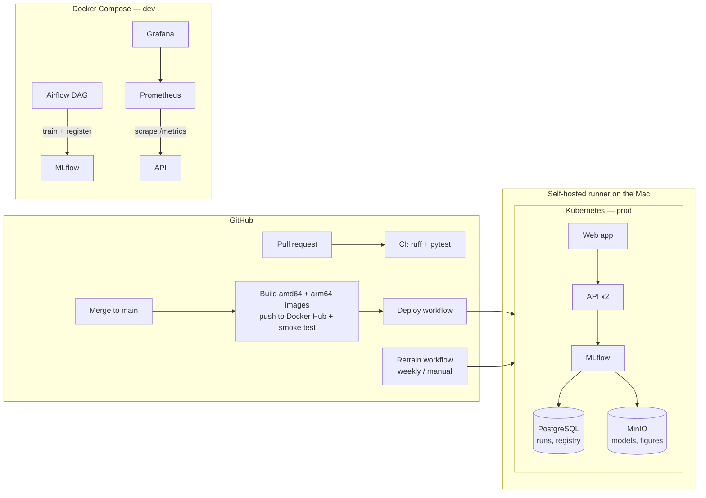
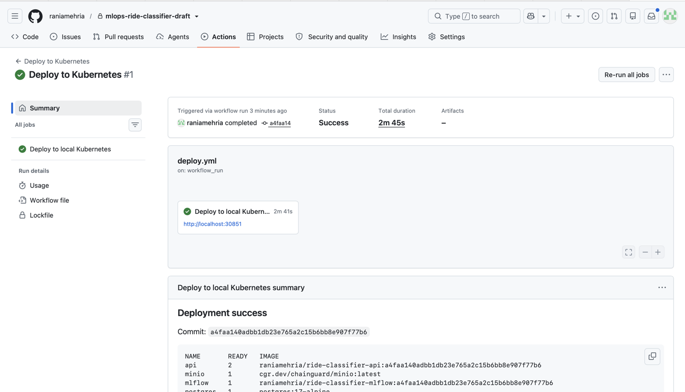
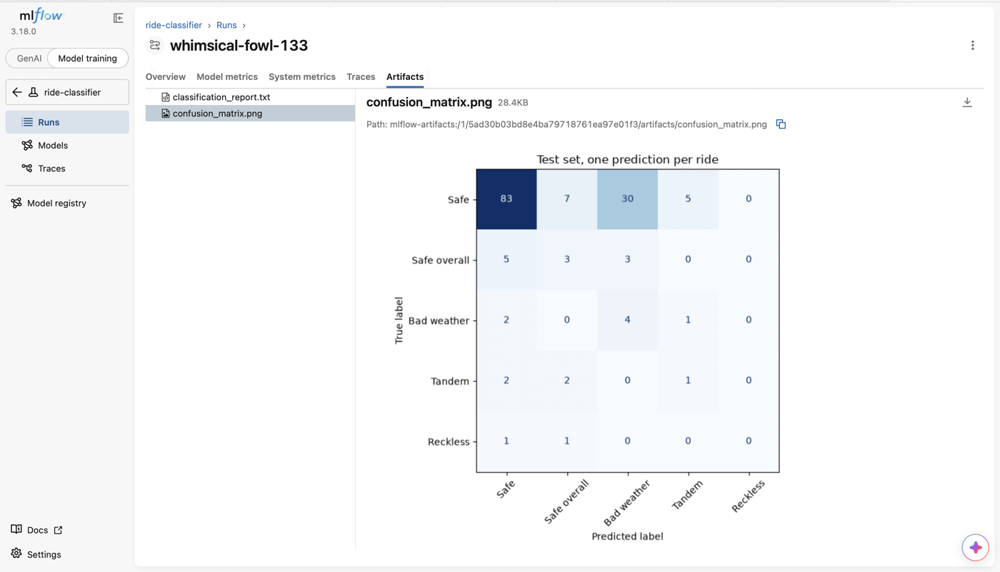
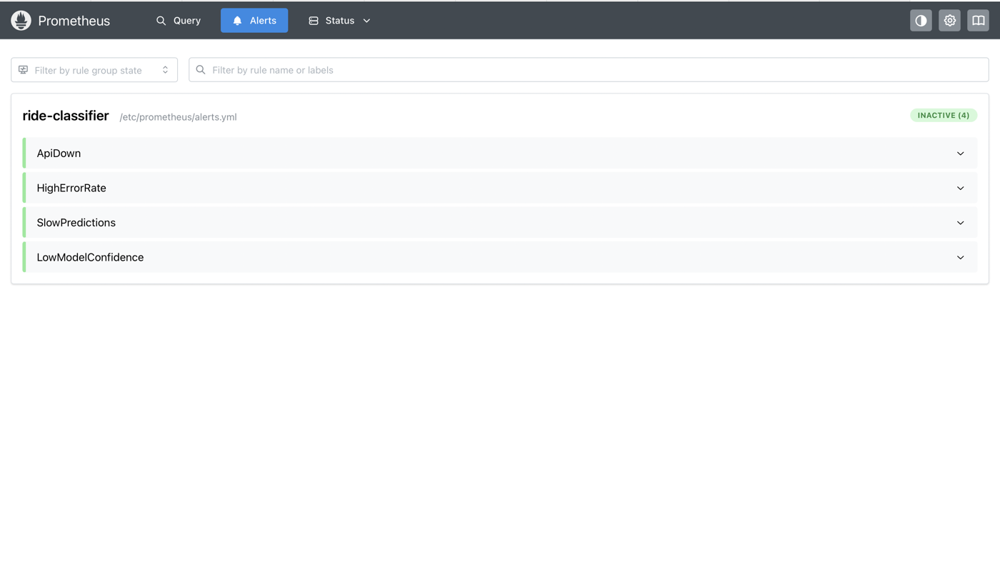

# Ride Classifier — MLOps pipeline

End-to-end MLOps project: a deep learning model that classifies micromobility rides from their IMU sensors
(**Safe, Safe overall, Bad weather, Tandem, Reckless**), with experiment tracking, a model registry,
an API, a web app, CI/CD, a local Kubernetes production environment, orchestration and monitoring.

> Albert School — M2 MLOps & Model Deployment, November 2026

| | |
|---|---|
| **Docker images** | [`raniamehria/ride-classifier-api`](https://hub.docker.com/r/raniamehria/ride-classifier-api) · [`raniamehria/ride-classifier-webapp`](https://hub.docker.com/r/raniamehria/ride-classifier-webapp) · [`raniamehria/ride-classifier-mlflow`](https://hub.docker.com/r/raniamehria/ride-classifier-mlflow) (amd64 + arm64, tagged `latest` and `<commit sha>`) |
| **Stack** | PyTorch · MLflow 3.18 · PostgreSQL · MinIO · FastAPI · Streamlit · Docker Compose · Kubernetes (Docker Desktop) · GitHub Actions · Airflow 3.4 · Prometheus · Grafana · uv |

## Teams

| Member | Role | Scope | PRs |
|---|---|---|---|
| **Rania** | Architecture, quality & observability | Project structure, tests & CI, Prometheus/Grafana monitoring, README | #1 · #9 · #14 · #17 |
| **Luli** | Data & model | Data exploration, preprocessing, CNN & metrics, Airflow pipeline, feature store | #2 · #3 · #13 · #16 |
| **Wei-Ling** | Platform & deployment | Dockerfiles, Docker Hub images, Kubernetes, self-hosted runner deployment | #8 · #10 · #11 · #12 |
| **Chanelle** | Model lifecycle | MinIO storage, MLflow tracking & registry, FastAPI serving, Streamlit web app, retraining | #4 · #5 · #6 · #7 · #15 |

Each PR is reviewed by at least one other member before merge. 
---

## Architecture



Two environments, as required:

| | Dev (Docker Compose) | Prod (Kubernetes, Docker Desktop) |
|---|---|---|
| Start | `docker compose up -d --build` | `kubectl apply -k k8s/` (automated by CD) |
| Images | built locally | pulled from Docker Hub, pinned to the commit SHA |
| API | http://localhost:8000/docs | http://localhost:30800/docs (2 replicas) |
| Web app | http://localhost:8501 | http://localhost:30851 |
| MLflow | http://localhost:5001 | http://localhost:30500 |
| MinIO console | http://localhost:9001 | http://localhost:30901 |
| Airflow | http://localhost:8080 (profile `airflow`) | — |
| Grafana / Prometheus | http://localhost:3000 · http://localhost:9090 | — |

---

## Data

`GBG500`: 500 rides in Gothenburg, ~5 min each, 10 measurements per second, 6 sensors
(accelerometer `ax ay az` in m/s², gyroscope `rx ry rz`). Heavily imbalanced:

| Safe | Safe overall | Bad weather | Tandem | Reckless |
|---|---|---|---|---|
| 416 | 38 | 22 | 18 | 6 |

Findings from the exploration (`notebooks/01_exploration.py`): 0.7% of rows have no sensor value (439 rides),
one duplicated timestamp, gyroscope values ~30× larger than accelerometer values, similar ride durations across classes
(so duration cannot be used as a shortcut).


## Technical choices

| Choice | Why |
|---|---|
| **API input = CSV of one ride** (not an image) | The dataset contains sensor time series, no images. The CSV is the native format of the data. |
| **Supervised 5-class model, labels used for training on 70% of the rides** | The brief asks for a 5-class classifier. `data.txt` says labels are for evaluation: the 30% test rides are only used for evaluation. |
| **Split by ride, not by window** | Windows of one ride never end up in both train and test (no data leakage). |
| **60 s windows, 50% overlap** | Fixed input size for the network, and more training samples (4 Reckless training rides → 45 windows). |
| **Normaliser fitted on train only**, saved with the model | Test data stays unseen; the API applies exactly the same transformation. |
| **1D CNN + class-weighted loss** | Detects temporal patterns; weights stop the model from always answering "Safe". |
| **Ride-level prediction** = mean of window probabilities | Matches the API, which receives a whole ride. |
| **Macro F1 as the reference metric** | Accuracy is misleading: always answering "Safe" gives 83%. |
| **MLflow pyfunc bundling preprocessing + network** | The API sends a raw ride: no training/serving skew. |
| **`champion` alias moves only if macro F1 improves** | An automatic retraining can never degrade production. |
| **PostgreSQL + MinIO behind MLflow** | Model registry needs a database; artifacts in S3-compatible storage (requirement). |
| **uv** | Locked, reproducible dependencies (`uv.lock`); dependency groups keep PyTorch out of the web app image. |

## Results

Test set: 150 rides never seen during training.

| Model | Accuracy | Balanced accuracy | **Macro F1** | F1 Reckless |
|---|---|---|---|---|
| Baseline: always "Safe" | 0.833 | 0.200 | 0.182 | 0.000 |
| Baseline: stratified random | 0.827 | 0.198 | 0.181 | 0.000 |
| **1D CNN (champion v1)** | 0.607 | 0.342 | **0.272** | 0.000 |

The CNN beats the baselines on macro F1 (+50%). Accuracy goes down on purpose: class weights trade some "Safe"
precision for the rare classes (Bad weather: 4/7 rides found). **Reckless is not detected**: only 6 rides in total
(4 for training, 2 for testing) — a data limitation, see [Limits](#limits-and-next-steps).


---

## Quick start

Requirements: Docker Desktop (Kubernetes enabled for prod), [uv](https://docs.astral.sh/uv/), the data in `data/raw/`
(`GBG500.parquet`, `GBG500_labels.csv`, not versioned).

```bash
cp .env.example .env                       # then set the passwords
uv sync                                    # Python environment from uv.lock
docker compose up -d --build               # dev stack: MinIO, PostgreSQL, MLflow, API, web app, Prometheus, Grafana
uv run python -m ride_classifier.data      # preprocessing
uv run python -m ride_classifier.train     # train, log and register in MLflow (champion if better)
docker compose restart api                 # the API loads the champion
```

Try it: http://localhost:8501 (web app) or http://localhost:8000/docs (Swagger) with a file from `examples/`.

### Production (Kubernetes)

```bash
kubectl config use-context docker-desktop
kubectl apply -f k8s/namespace.yaml
kubectl create secret generic ride-classifier-secrets -n ride-classifier --from-env-file=.env
kubectl apply -k k8s/
MLFLOW_TRACKING_URI=http://localhost:30500 uv run python -m ride_classifier.train   # first champion
kubectl rollout restart deploy/api -n ride-classifier
```

After that, every merge to `main` is deployed automatically (see CI/CD).

### Orchestration (Airflow)

```bash
docker compose --profile airflow up -d --build airflow    # http://localhost:8080
```

DAG `ride_classifier_training` (weekly + manual): `check_raw_data → preprocess → train_and_register → reload_api`.
Airflow and the ML libraries have conflicting dependencies, so the project lives in its own virtual env inside the
Airflow image and the DAG calls that Python.

### Monitoring

```bash
docker compose up -d prometheus grafana
uv run python scripts/send_traffic.py --n 60     # real rides + 10% invalid files
```

The API exposes `/metrics`. Grafana (http://localhost:3000) shows four layers:

| Layer | Metrics |
|---|---|
| API | requests per route and status, errors, p50/p95 latency |
| Model | predicted class mix and mean confidence (drift signals), served model version |
| Data | length of the received rides |

Alert rules (`monitoring/prometheus/alerts.yml`): `ApiDown`, `HighErrorRate` (>5% 5xx), `SlowPredictions`
(p95 > 2 s), `LowModelConfidence` (mean < 50%: incoming rides may differ from training data).

---

## API

| Route | Purpose |
|---|---|
| `POST /predict` | CSV of one ride (`time_index, ax, ay, az, rx, ry, rz`) → class, probabilities, model version and run id |
| `GET /health` | 200 when a model is loaded, 503 otherwise (Kubernetes readiness) |
| `GET /model` | served model name, alias, version, MLflow run id |
| `POST /model/reload` | load the current champion without restarting |
| `GET /metrics` | Prometheus metrics |

Clear errors: 422 (missing columns, unreadable or empty file), 413 (too many rows), 503 (no model).


## CI/CD (GitHub Actions)

| Workflow | Trigger | What it does |
|---|---|---|
| `ci.yml` | every pull request, push to `main` | ruff (lint + format), unit + integration tests with coverage. Required to merge (`main` is protected). |
| `docker.yml` | push to `main` | builds the 3 images for **amd64 and arm64** natively on GitHub runners, merges them under `<sha>` and `latest`, pushes to Docker Hub, smoke tests the API image |
| `deploy.yml` | after a successful image build | on the **self-hosted runner**: pins the images to the commit SHA, `kubectl apply -k`, waits for the rollout, smoke tests `/health`, `/model` and a real `/predict`, **automatic rollback** on failure |
| `retrain.yml` | weekly + manual | on the self-hosted runner: retrain, register in the prod MLflow, rolling restart of the API **only if a new champion** was promoted |

Security: actions pinned to commit SHAs; deployments never triggered by a pull request; one deployment at a time;
secrets in GitHub secrets and a Kubernetes Secret (never in git).



## Tests

```bash
uv run pytest --cov           # 24 unit + integration tests (no MLflow needed: the API is tested with a fake model)
uv run pytest -m e2e          # end-to-end: real CSV → API in Docker → champion model from MLflow/MinIO
uv run ruff check . && uv run ruff format --check .
```

Coverage ~60%: training code needs the data and an MLflow server, it is exercised by the e2e test, Airflow and the
retraining workflow rather than by CI.

---

## Repository structure

```
src/ride_classifier/   data.py (preprocessing) · model.py (CNN) · train.py (MLflow) · pyfunc_model.py
                       evaluate.py · baseline.py · api.py (FastAPI + metrics)
webapp/app.py          Streamlit app (calls the API)
tests/                 unit/ · integration/ · e2e/
notebooks/             data exploration
dags/                  Airflow training DAG
docker/                Dockerfiles (api, webapp, mlflow, airflow)
k8s/                   Kubernetes manifests (kustomize)
monitoring/            Prometheus config + alerts, Grafana dashboard
.github/workflows/     ci, docker, deploy, retrain
scripts/               send_traffic.py · champion_version.py
examples/              two real rides to try the API
```

## Problems met and how we solved them

| Problem | Diagnosis | Fix |
|---|---|---|
| `minio/minio` images removed from Docker Hub (Sept. 2026) | `pull access denied` | `cgr.dev/chainguard/minio` (MinIO rebuilt from source), bucket created with boto3 instead of `minio/mc` |
| MLflow options silently ignored | the bucket stayed empty although runs were logged | YAML folded block: extra indentation kept the line breaks → rewritten as a list |
| MLflow crash with PostgreSQL | `No module named 'psycopg'` | SQLAlchemy 2.1 uses psycopg 3 by default |
| MLflow **OOMKilled** in Kubernetes | measured memory per process: 4 workers + a GenAI job runner = 2.7 GB | `--workers 2`, `MLFLOW_SERVER_ENABLE_JOB_EXECUTION=false` → 0.8 GB |
| MLflow crashing when starting before PostgreSQL | `CrashLoopBackOff` | initContainer `wait-for-postgres` |
| Apple Silicon Mac vs amd64 GitHub runners | images must run on both | multi-arch build on native amd64 and arm64 runners |
| Docker Hub login failing after fixing the variable | re-runs reuse the variables of the first attempt | start a new run instead of re-running |
| API image `Permission denied` | local files were `600`, container runs as non-root | `chmod -R a+rX` in the Dockerfiles |

## Limits and next steps

- **Reckless is not detected** (6 rides in total). Next: use the 3,490 unlabelled rides of `SRV3490` for
  self-supervised pre-training, or treat Reckless as anomaly detection, as `data.txt` suggests.
- Test set of 150 rides only: scores vary between runs and machines → cross-validation.
- Monitoring runs in the dev environment; next step: deploy Prometheus and Grafana in the cluster with the official Helm charts.
- MinIO image only available as `latest` for free (Chainguard) → mirror a fixed version in our own registry.

## Screenshots

| | |
|---|---|
|  |  |
|  |  |
|  |  |
