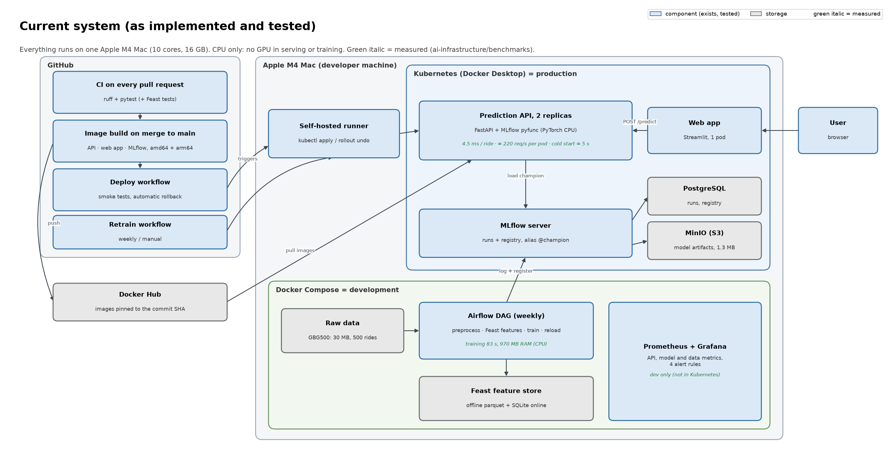
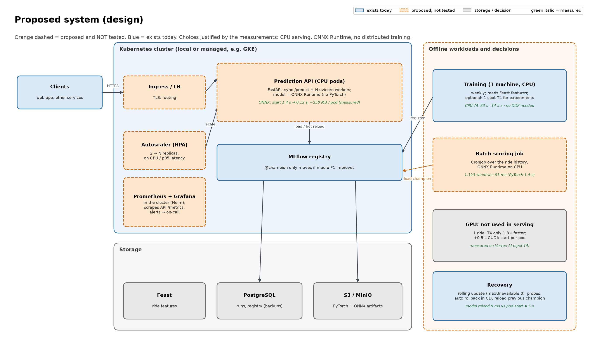

# AI Infrastructure — Ride Classifier

AI Infrastructure contribution for the existing MLOps project (see the [main README](../README.md)).
The goal is not a new model. It explains what the model needs to run, measures inference, tests one
optimization and designs a scalable, cost-aware serving system.

> **Measure, do not claim.** Every number below is tagged **[measured]** (with how), **[estimate]** (with the
> assumption), or **To measure**.

| Deliverable | File | Status |
|---|---|---|
| Current system diagram | [architecture/current-system.png](architecture/current-system.png) · [.md](architecture/current-system.md) | Done |
| Proposed system diagram | [architecture/proposed-system.png](architecture/proposed-system.png) · [.md](architecture/proposed-system.md) | Done (design, not tested) |
| Baseline benchmark | [benchmarks/benchmark.ipynb](benchmarks/benchmark.ipynb) · [benchmark.py](benchmarks/benchmark.py) · [baseline-results.csv](benchmarks/baseline-results.csv) | Done (3 runs) |
| CPU vs GPU (GCP, T4) | [benchmarks/device_benchmark.py](benchmarks/device_benchmark.py) · [train_benchmark.py](benchmarks/train_benchmark.py) · [vertex-t4/](benchmarks/vertex-t4/) · [gpu/](gpu/) | Done (1 run) |
| Optimization comparison | [optimization/comparison.ipynb](optimization/comparison.ipynb) · [compare.py](optimization/compare.py) · [results.csv](optimization/results.csv) | Done (ONNX Runtime, 3 runs) |
| Distributed training decision | [distributed-training/technical-analysis.md](distributed-training/technical-analysis.md) | Draft |
| Scaling, cost and resilience | [cost-resilience/infrastructure-plan.md](cost-resilience/infrastructure-plan.md) | To do |

## 1. Inventory of the current MLOps system

| Component | Implementation | Where it runs |
|---|---|---|
| Preprocessing | `ride_classifier.data`: cleaning, 60 s windows (600 × 6), normalisation fitted on train | Local (Mac), Airflow (Docker) |
| Feature store | Feast, local (parquet offline, SQLite online), `feature_repo/` | Local, Airflow |
| Training | PyTorch 1D CNN, class-weighted loss, 20 epochs, CPU | Local (Mac), Airflow, GitHub self-hosted runner |
| Tracking / registry | MLflow 3.18 + PostgreSQL + MinIO (S3), alias `champion` | Docker Compose (dev), Kubernetes (prod) |
| Serving | FastAPI loading the MLflow pyfunc (preprocessing + CNN), 2 replicas | Docker Compose, Kubernetes (Docker Desktop) |
| CI/CD | GitHub Actions: ruff + pytest, multi-arch images on Docker Hub, deploy with rollback | GitHub runners + self-hosted Mac runner |
| Monitoring | Prometheus + Grafana (API, model, data layers), 4 alert rules | Docker Compose (dev only) |

The model does **not** run on Colab or GCP: everything runs on one Apple Silicon Mac, in prod on the local
Kubernetes cluster of Docker Desktop. (GCP was used only for the CPU vs GPU experiment, see § 3.1.)



Both diagrams are drawn by code: `uv run python ai-infrastructure/architecture/draw.py` (matplotlib).

## 2. Resource sizing

| Item | Value | Source |
|---|---|---|
| Framework | PyTorch 2.15.0 (CPU build on Linux images), Python 3.12 | [measured] `uv.lock`, `torch.__version__` |
| Model | 1D CNN, 3 conv blocks (32-64-64) + linear, **24,677 parameters** | [measured] `sum(p.numel())` |
| Serialized weights | **107,550 bytes (≈ 0.1 MB)** `state_dict` | [measured] `torch.save` to memory |
| MLflow model artifact (weights + normalizer + code + env files) | **1.27 MB** | [measured] `benchmark.py`, downloaded artifact |
| Dataset used | GBG500: **30.2 MB** parquet, **500 rides**, **1,529,547 rows** (1,807–4,767 rows per ride, median 2,906) | [measured] file size, pandas |
| Labels | 500 rides, 5 classes (Safe 416, Safe overall 38, Bad weather 22, Tandem 18, Reckless 6) | [measured] `GBG500_labels.csv` |
| Unused dataset | SRV3490: 268.2 MB parquet, 3,490 rides | [measured] file size |
| Model input | windows of shape (600 time steps, 6 sensors); one ride ≈ 9 windows | [measured] `data.py` constants |
| Batch size (training) | 64 windows | `train.PARAMS` |
| Hardware | Apple M4, 10 CPU cores, 16 GB unified memory, macOS 15.7.2; MPS available but **not used** (training is CPU) | [measured] `sysctl`, `torch.backends.mps` |
| GPU / VRAM | None used locally. CPU vs GPU measured on GCP: 1 NVIDIA T4 (15 GB); peak VRAM 327 MB (inference, 1,323 windows) and 60 MB (training) | [measured] [§ 3.1](#31-cpu-vs-gpu-on-gcp-vertex-ai-t4) |
| Preprocessing duration | **4.8 s** wall, peak RSS 731 MB (350 train rides → 3,026 windows, 150 test rides → 1,323 windows) | [measured] `/usr/bin/time -l python -m ride_classifier.data` |
| Training duration | **82.8 s** wall (20 epochs, CPU, includes baselines, feature store model and MLflow logging) | [measured] `/usr/bin/time -l python -m ride_classifier.train` |
| Peak training RAM | **970 MB** (max RSS) | [measured] same command |
| API process RAM | **≈ 218 MB** after load (median of 3 runs; one run reached 435 MB). k8s request 768 Mi, limit 2 Gi | [measured] `ps rss` of the uvicorn process |

## 3. Baseline benchmark

Procedure, charts and interpretation: [benchmarks/benchmark.ipynb](benchmarks/benchmark.ipynb). All values come from
[baseline-results.csv](benchmarks/baseline-results.csv) (raw per-request latencies in [benchmarks/raw/](benchmarks/raw/)):
**median of 3 runs, min–max in brackets**, 10 warm-up calls, 200 timed calls per run, 1 ride (≈ 9 windows) per call.

| Metric | Value | Measurement conditions |
|---|---|---|
| Model and version | `ride-classifier` v1 (@champion), macro F1 0.272 (same as the README champion v1) | PyTorch 2.15.0 CPU, MLflow 3.18 pyfunc; trained with `train.py` into a local SQLite MLflow registry |
| Hardware | Apple M4, 10 cores (4 torch threads), 16 GB, macOS 15.7 | shared with other Docker stacks ([background load](benchmarks/raw/background-load.txt)); no GPU |
| Model size (MB) | 0.11 (weights) · 1.27 (MLflow artifact) | `ride_cnn.pt` state_dict / whole pyfunc folder |
| Model loading time | **cold ≈ 5.0 s** (imports 2,225 ms + `load_model` 2,733 ms) · **warm reload 8 ms** · download 5 ms | cold: new Python process, median of 5 = API pod start; warm: `load_model` again in the same process = `POST /model/reload`; download from the local registry (a file copy; with the prod MinIO it adds network time) |
| Mean latency (ms) | **model 1.78** [1.76–2.03] · **API 4.48** [3.91–5.43] | model: `pyfunc.predict` in-process; API: `POST /predict` (CSV upload), 1 uvicorn worker, concurrency 1 |
| p95 latency (ms) | **model 2.34** [2.33–3.26] · **API 6.51** [5.29–11.23] | same |
| Throughput (requests/s) | **API 219** at 1 client [158–223] · 226 at 4 [148–253] · 245 at 8 [245–246] | 20 s closed loop per level, 0 errors; model alone: 562 rides/s sequential |
| Memory usage (MB) | API process ≈ 218 [218–435] | RSS of the uvicorn process after each load test |
| Classification quality | macro F1 **0.272**, accuracy 0.607 | 150 held-out rides (`data.split_rides`) |

Main findings:

- **Where the time goes** (model level, 1.8 ms): preprocessing 0.49 ms, CNN forward 0.77 ms, the rest is pyfunc
  overhead (schema check, DataFrame output). The API adds ≈ 2 ms (HTTP, multipart, CSV parsing, validation).
- **One worker serves one request at a time**: throughput stays ≈ 220–245 requests/s from 1 to 8 clients, while p95
  latency grows from 7 ms to 29 ms (4 clients) and 49 ms (8 clients). Cause: `/predict` is `async def` but calls the
  model synchronously, which blocks the uvicorn event loop. Scaling = more workers / replicas, not more concurrency.
- **Loading dominates start-up, not the model**: a cold start costs ≈ 5 s, almost all Python / MLflow / PyTorch
  imports (the weights are 0.1 MB), while a warm reload takes 8 ms. Hot-reloading a new champion with
  `POST /model/reload` is therefore much cheaper than restarting pods; on Kubernetes the 5 s cold start is covered by
  the startup probe (up to 5 min) and the rolling update keeps the old pods serving meanwhile.
- **Not tested here**: GPU (see [§ 3.1](#31-cpu-vs-gpu-on-gcp-vertex-ai-t4)), the Kubernetes deployment (2 replicas), the production MLflow. The benchmark can be re-run
  against prod by setting `MLFLOW_TRACKING_URI` (see the notebook).
- During the first training attempt PyTorch raised a transient internal error
  (`Could not find schema for aten::_to_copy`); the identical command succeeded on the second try and the error could
  not be reproduced.

### 3.1 CPU vs GPU on GCP (Vertex AI, T4)

**Same model, same library versions, same machine; only the device changes.** One Vertex AI custom job
(project `advanced-cloud-ai-i2`, `europe-west4`) runs the inference and training benchmarks on the machine's CPU, then
on its GPU:

| Item | Value |
|---|---|
| Machine | `n1-standard-4`: Intel Xeon @ 2.00 GHz, 4 vCPU (PyTorch uses 2 threads), 15 GB RAM |
| GPU | 1 × NVIDIA Tesla T4, 15 GB, driver 580.178.04, **spot** |
| Software | PyTorch **2.15.0** (CUDA 13.2 build, same version as the Mac baseline), all other packages pinned from `uv.lock` |
| Model | the same `ride-classifier` v1 as the CPU baseline (macro F1 0.272), bundled in the image |
| Workload | the 150 held-out test rides; 10 warm-up + 200 timed calls; `torch.cuda.synchronize()` before every clock read |
| Code | [device_benchmark.py](benchmarks/device_benchmark.py) (inference), [train_benchmark.py](benchmarks/train_benchmark.py) (training: the loop of `train.train()`), [gpu/](gpu/) (image, job) |
| Raw results | [vertex-t4/inference-results.csv](benchmarks/vertex-t4/inference-results.csv), [vertex-t4/training-results.csv](benchmarks/vertex-t4/training-results.csv) — **1 run**, 2026-11-21 |

Why a Vertex AI job and not a VM: the project's Compute Engine GPU quota (`GPUS_ALL_REGIONS`) is 0, and so are the
on-demand Vertex AI T4 / L4 quotas in the regions we tried (europe-west4, europe-west1, us-central1); spot GPUs on
Vertex AI are allowed. A job also stops by itself (hard cap 45 min), so nothing
keeps billing.

**Inference**

| Metric | CPU | GPU (T4) | GPU vs CPU |
|---|---|---|---|
| **1 ride (≈ 9 windows), mean latency** | 5.10 ms | **3.86 ms** | 1.3× faster |
| 1 ride, p95 latency | 6.45 ms | 4.83 ms | 1.3× |
| — preprocessing (numpy/pandas, always on CPU) | 2.36 ms | 2.37 ms | same |
| — host → device transfer | 0.00 ms | 0.09 ms | GPU-only cost |
| — CNN forward | 2.40 ms | 1.05 ms | 2.3× |
| **First prediction** (network to device + first forward) | 13 ms | **461 ms** | 35× slower (CUDA initialisation) |
| Batch of 64 windows | 10.1 ms (6,343 windows/s) | 1.35 ms (47,327 windows/s) | 7.5× |
| Batch of 256 windows | 115 ms (2,232 windows/s) | 3.67 ms (69,685 windows/s) | 31× |
| **Batch of 1,323 windows** (whole test set) | 768 ms (1,723 windows/s) | **17.1 ms (77,158 windows/s)** | **45×** |
| Peak memory | 1,476 MB RAM | 1,632 MB RAM + **327 MB VRAM** | |
| macro F1 (150 rides) | 0.272 | 0.272 | identical |

**Training** (20 epochs, batch 64, 3,026 windows, same seed)

| Metric | CPU | GPU (T4) | GPU vs CPU |
|---|---|---|---|
| **Total training time** | 74.3 s | **5.0 s** | **15×** |
| Median epoch (2..20) | 3.70 s | 0.22 s | 17× |
| First epoch | 3.90 s | 0.79 s | |
| Throughput | 819 windows/s | 14,036 windows/s | 17× |
| Peak memory | 1,215 MB RAM | 1,688 MB RAM + **60 MB VRAM** | |
| macro F1 (150 rides) | 0.298 | 0.180 | see below |

**Interpretation and decision**

- **Serving stays on CPU.** The API scores one ride per request: there the GPU is only 1.3× faster, because half
  the time is preprocessing (on the CPU in both cases) and the CNN (24,677 parameters, ≈ 9 windows) is too small to
  keep a GPU busy; the transfer adds 0.09 ms and the first prediction pays ≈ 0.5 s of CUDA initialisation per pod. A
  gain of ≈ 1.2 ms per request does not justify a GPU per replica.
- **The GPU only pays off for large batches**: 31–45× from 256 windows up (CPU throughput falls for large batches,
  the GPU keeps rising until ≈ 1,000 windows). Useful for scoring many rides offline, not for the API.
- **Training**: 15× faster on the T4, but the CPU needs only 74 s, so the gain is about one minute per training run;
  CPU training on one machine stays sufficient.
- **No distributed training (DDP / FSDP / ZeRO)**: one T4 trains the model in 5 s using 60 MB of its 15 GB.
  There is nothing to split; splitting it over 2 GPUs would add All-Reduce communication for no gain.
- **Training quality differs between devices (0.298 vs 0.180)**: not a GPU defect. With the same seed, the GPU draws
  different random numbers (dropout) and uses different cuDNN algorithms, so it trains a different model; with 150
  test rides (2 Reckless) macro F1 varies a lot between runs. Inference with the same weights gives exactly the same
  score on both devices (0.272), which shows the computation is equivalent. Comparing training quality fairly needs
  several seeds per device (not done).
- **Limits**: one run (no min–max); spot GPU; the cloud CPU uses 2 threads, slower than the Mac (4 threads), so CPU
  vs GPU is compared on the **same** cloud machine and the Mac stays the local baseline.

**Reproduce** (from the project root, the data in `data/raw/`, the model in the MLflow registry):

```bash
bash ai-infrastructure/gpu/build.sh        # builds and pushes the image, prints its name
sed "s#imageUri: IMAGE.*#imageUri: <image printed above>#" ai-infrastructure/gpu/job.yaml > /tmp/job.yaml
gcloud ai custom-jobs create --project=advanced-cloud-ai-i2 --region=europe-west4 \
  --display-name=ride-classifier-cpu-vs-gpu --config=/tmp/job.yaml
# results: the CSV blocks between CSV-BEGIN / CSV-END in the job logs
gcloud logging read 'resource.type="ml_job" AND resource.labels.job_id="<job id>"' \
  --project=advanced-cloud-ai-i2 --order=asc --format='value(textPayload)'
```

Two image settings were needed for the GPU to be visible in the container (see [gpu/Dockerfile](gpu/Dockerfile)):
`NVIDIA_VISIBLE_DEVICES` / `NVIDIA_DRIVER_CAPABILITIES`, and `/usr/local/nvidia/{bin,lib64}` in `PATH` /
`LD_LIBRARY_PATH`, where Vertex AI mounts the driver.

## 4. Optimization: ONNX Runtime

**Baseline**: the CNN run by PyTorch 2.15 eager (`torch.no_grad()`, what the MLflow pyfunc does).
**Optimized**: the same weights exported to ONNX (opset 18, dynamic batch, 124 KB) and run by ONNX Runtime 1.32 on
CPU with all graph optimizations. Code side by side in [optimization/](optimization/): [runtimes.py](optimization/runtimes.py)
(both runtimes), [export_onnx.py](optimization/export_onnx.py), [compare.py](optimization/compare.py), notebook
[comparison.ipynb](optimization/comparison.ipynb), raw results [results.csv](optimization/results.csv).

**Hypothesis (written before measuring, saved in the notebook):** the network for one ride ≈ 25 % faster (Conv + ReLU
fusion, BatchNorm folded), so the whole ride ≈ 15 % faster (at most ≈ 60 %, Amdahl); no real gain for large batches
(compute-bound); lower cold start and memory (no PyTorch: 83 MB instead of 565 MB installed); same macro F1.

**Fair comparison:** same Mac M4, 4 threads for both, same weights, same preprocessing and post-processing (numpy),
same 150 test rides, 10 warm-up + 200 timed calls, 3 runs alternating the order; cold start in a new process
(median of 5, dataset not loaded). Correctness before timing: same prediction on 150/150 rides, logits differ by
< 2e-6 ([export-check.json](optimization/model/export-check.json)).

| Metric (median of 3 runs [min–max]) | Baseline: PyTorch | Optimized: ONNX Runtime | Interpretation |
|---|---|---|---|
| Mean latency, 1 ride (ms) | 1.51 [1.49–1.60] | 1.88 [1.22–2.47] | no stable gain: −19 % in one run, +66 % in another |
| — network only, 1 ride (ms) | 0.75 [0.72–0.82] | 0.89 [0.62–1.16] | < 1 ms either way; thread scheduling dominates |
| p95 latency, 1 ride (ms) | 2.22 [2.11–2.28] | 3.32 [1.66–4.21] | ONNX Runtime more variable at this size |
| Throughput, batch of 1,323 windows | 944 windows/s (1,402 ms) | **14,265 windows/s (93 ms)** | **15× faster** (10–16× from 64 windows up) |
| Throughput, 9 windows (≈ 1 ride) | 12,849 windows/s | 9,347 windows/s | small batches: no gain |
| Cold start: import + load + 1st prediction (ms) | 1,404 | **120** | **12× faster** (import 1,400 → 93 ms) |
| Memory: peak process RSS (MB) | 558 | **303** | **−46 %** (no PyTorch in the process) |
| Classification quality (macro F1, 150 rides) | 0.272 | 0.272 | unchanged (150/150 same predictions) |

**Hypothesis check**: confirmed for start-up, memory and quality; **not confirmed** for one ride (no stable gain);
**wrong for large batches**, in the good direction (15× instead of "no gain").

**Why** ([diagnostics.py](optimization/diagnostics.py) → [diagnostics.txt](optimization/diagnostics.txt)):

- The PyTorch 2.15 build for macOS / ARM has **no oneDNN** (`torch.backends.mkldnn.is_available()` is `False`), so
  its CPU convolution falls back to a slow path: per-window throughput drops from ≈ 12,800 (9 windows) to ≈ 900
  windows/s (1,323 windows), and more threads do not help. ONNX Runtime uses its own optimised CPU kernels (MLAS) and
  scales with threads (206 → 132 → 109 ms for 1 → 2 → 4 threads on 1,323 windows). The gain comes from the kernels,
  not from the fusions; a contiguous input (instead of the transposed view) does not change PyTorch's speed.
- For one ride (≈ 9 windows) both need < 1 ms and the result is dominated by thread scheduling on a shared Mac; the
  fusions save too little to show. For the API, the network is only ≈ 0.8 ms of ≈ 4.5 ms per request anyway.
- Start-up: importing ONNX Runtime takes ≈ 0.09 s against ≈ 1.4 s for PyTorch. The full API start-up would drop by
  ≈ 1.3 s, not to 0.1 s, because MLflow and pandas are still imported.

**Decision**: keep the PyTorch pyfunc as the registered, served model for now; propose ONNX Runtime for
**batch scoring** (15× on CPU: 93 ms for the whole test set on the Mac CPU, close to the 17 ms of the T4 GPU, without a
GPU) and for a **lighter API image** without PyTorch (faster start, ≈ 250 MB less memory per replica). Serving ONNX in
the API is **not done**: it changes the MLflow model (export at training time, `onnx` flavour) and needs the team's
agreement.

**Limits**: one machine (Mac M4 shared with other Docker stacks, [background load](optimization/background-load.txt)),
3 runs; the single-ride numbers are noisy; MLflow loading is excluded from both cold starts.

## 5. Distributed training, scaling, cost and resilience



Proposed architecture ([details](architecture/proposed-system.md)); every orange element is a **design, not tested**:

- **Serving stays on CPU** (§ 3.1: the T4 is only 1.3× faster for one ride, and costs ≈ 0.5 s of CUDA start per pod).
- **ONNX Runtime in the API pods** (§ 4: start-up 1.4 s → 0.12 s, −250 MB per process, same predictions).
- **Scale out, not up**: sync `/predict` + several uvicorn workers per pod (one worker serves one request at a time,
  § 3), and an autoscaler (HPA) adding replicas on CPU / p95 latency.
- **Batch scoring** with ONNX Runtime on CPU (§ 4: 1,323 windows in 93 ms), no GPU needed.
- **Training on one machine**, no DDP (§ 3.1: 74–83 s on CPU, 5 s and 60 MB VRAM on one T4).
- **Monitoring in the cluster** (today: dev only) and **recovery** with what exists: rolling update, automatic
  rollback in CD, hot reload of the previous champion (8 ms vs ≈ 5 s pod start).

- Distributed training: [distributed-training/technical-analysis.md](distributed-training/technical-analysis.md)
- Serving architecture, scaling, monitoring, costs, rollback: [cost-resilience/infrastructure-plan.md](cost-resilience/infrastructure-plan.md)

## Owners and next actions

| Task | Owner | Due |
|---|---|---|
| Resource sizing (training time, RAM) | To assign | |
| Baseline benchmark | To assign | |
| Optimization | To assign | |
| Distributed training analysis | To assign | |
| Architecture, cost and resilience | To assign | |
