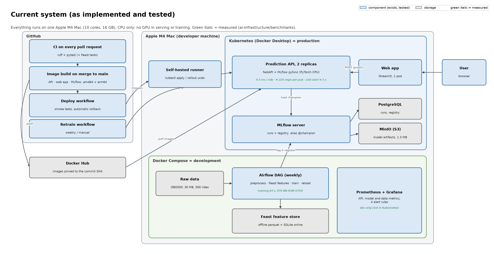
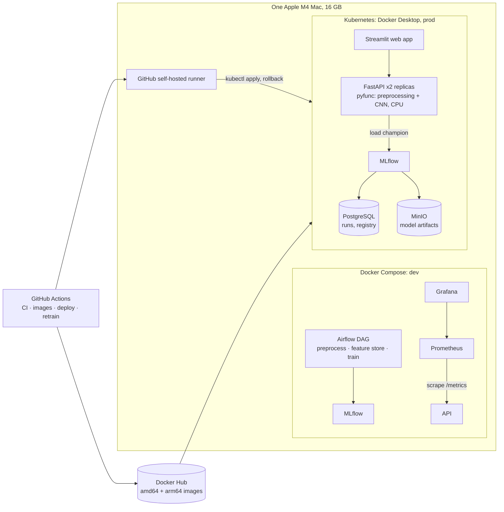

# Current system (as implemented)

Diagram of what exists **today** (not the proposed system).

The PNG is drawn by [draw.py](draw.py) (`uv run python ai-infrastructure/architecture/draw.py`). The same system as
Mermaid, rendered directly by GitHub:

