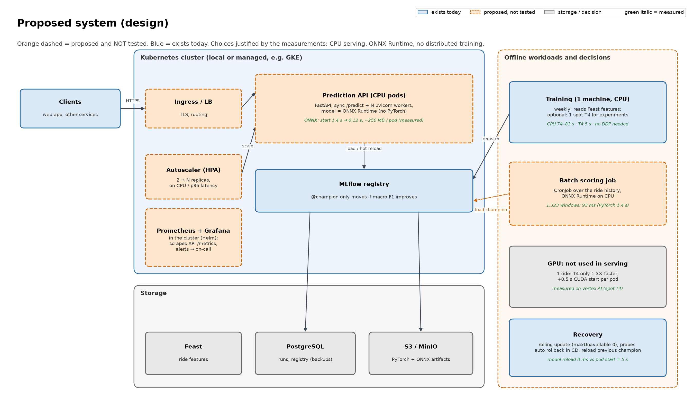

# Proposed system (design)

Drawn by [draw.py](draw.py). **Orange dashed = proposed and not tested**; blue = exists today; green italic = measured.
Each choice comes from a measurement in `ai-infrastructure/`:

| Element | Status | Why (measurement) |
|---|---|---|
| Ingress / load balancer | proposed | single entry point, TLS; today the API is a NodePort |
| API pods on **CPU**, model in **ONNX Runtime** | proposed | GPU only 1.3× faster for one ride (+0.5 s CUDA start); ONNX: start 1.4 s → 0.12 s, −250 MB per process, same predictions |
| Sync `/predict` + N uvicorn workers | proposed | today one worker serves one request at a time (`async def` blocks the event loop): throughput flat at ≈ 220–245 req/s from 1 to 8 clients |
| Autoscaler (HPA), 2 → N replicas | proposed | scale out on CPU / p95 latency; needs metrics-server; **not tested** |
| MLflow registry, `@champion` | exists | alias only moves if macro F1 improves |
| Prometheus + Grafana in the cluster | proposed | today in Docker Compose (dev) only |
| Batch scoring job (CronJob) | proposed | ONNX Runtime on CPU: 1,323 windows in 93 ms (PyTorch 1.4 s, T4 17 ms) |
| Training on one machine, CPU | exists | 74–83 s on CPU; 5 s and 60 MB VRAM on one T4: no DDP needed |
| Recovery | exists | rolling update (maxUnavailable 0), probes, automatic rollback in CD, reload of the previous champion (8 ms vs ≈ 5 s pod start) |
